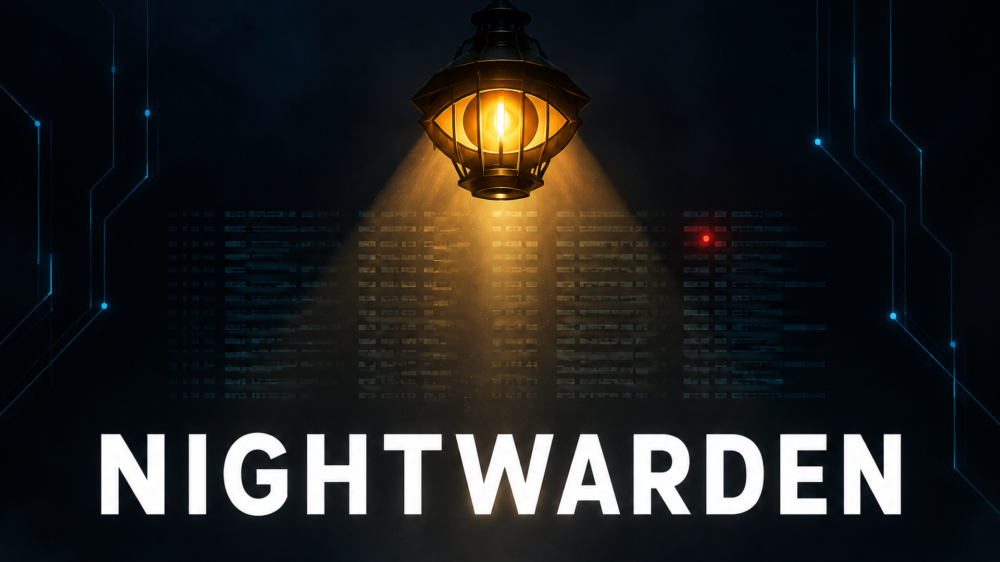
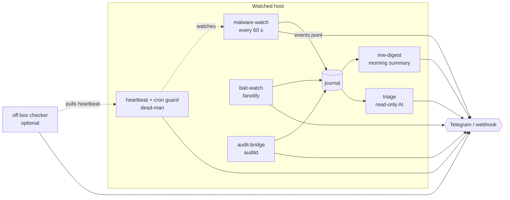

<p align="center">
  
</p>

<h1 align="center">Nightwarden</h1>

<p align="center"><b>A night watchman for your Linux server: catches Mirai-class implants, stolen-key persistence and secret theft in seconds — and explains every alert in plain words.</b></p>

<p align="center">
  
  
  
  
  
</p>

<p align="center">
  <a href="#quick-start">Quick start</a> ·
  <a href="#why-this-exists">Why this exists</a> ·
  <a href="#features">Features</a> ·
  <a href="#how-it-works">How it works</a> ·
  <a href="README.ru.md">Русский</a>
</p>

---

## What you get

| 🕵️ Detect | 🪤 Trap | 🧠 Explain |
|---|---|---|
| Processes with a **deleted binary**, memfd execution, fake `[kworker]`, reverse shells, botnet listeners, new persistence (cron, systemd, `ld.so.preload`, ssh keys, sudoers…) | **Honeytoken files** that look like forgotten credentials. Judged by *behaviour*: "walks a directory" = quiet, "reads only secrets" = alarm | A **morning digest** instead of a flood, and an optional **AI triage** that investigates a red alert read-only and writes a verdict |

An alert looks like this (illustrative and shortened; the watcher's texts are currently Russian — see [Limitations](#limitations)):

```text
🚨 Process with a deleted binary talks to the network
Что случилось: процесс «irqbalance» (pid 4121) запущен из файла, которого
на диске уже нет, и держит соединение наружу.
Чем это грозит: так ведёт себя уже работающий вредонос.
Что сделано: снимок улик сохранён, дерево процессов заморожено и убито.
tech: pid=4121 exe=/tmp/.x (deleted) · 2026-… UTC · myhost
```

> [!NOTE]
> Nightwarden is **detection and containment**, not a firewall replacement. It assumes you also do the basics (see [Security](#security)).

## Why this exists

This project was written the week after a real breach of a small dev server.

> **The setup:** a web terminal (`ttyd`) listening on `0.0.0.0` with **no password**, host firewall **off**, reachable from the site's local network. Nothing exotic.

| When | What happened |
|---|---|
| **t = 0** | Someone on the site's local network reaches the open web terminal. Who, and how, was never established. |
| **t + 21 s** | A Mirai-family bot is downloaded and running. The whole intrusion takes **less than the 60-second tick** of any polling monitor. |
| **Then** | The implant disguises itself as `irqbalance` / `atd` / `[kworker]`, **deletes its own binary** and starts listening on telnet port 23. |
| **Afterwards** | It harvests `~/.ssh`, shell histories and every `*.env` / `*secret*` / `*token*` file on disk — **six passes**. |
| **~2.5 days later** | A human notices. Source of the intrusion is **never established**: there were no access logs, no auditd, no firewall log. |

What that taught, and what this repo does about each point:

| Lesson | Answer in Nightwarden |
|---|---|
| "No auth on a shell-giving service" is not a risk, it's an open door | [Security checklist](#security) first; detector flags new non-loopback listeners |
| The bot hid by name, so name-based checks fail | Judge by **facts**: `exe` marked `(deleted)`, `PF_KTHREAD` flag instead of the `[kworker]` name, `/proc/<pid>/fd` pointing at sockets |
| 21 s is faster than a 60 s poll | Optional **Falco/eBPF** kit for real-time; honeytokens fire on the *first read* |
| Secrets were stolen silently | **Bait files** + auditd rules on your real secret paths |
| Nobody knew for 2.5 days | **Dead-man switch** (heartbeat, independent guard, optional off-box checker): silence is an alert |
| No logs = no answer to "how did they get in" | Logging is set up **in advance**: events journal, auditd, off-box audit forwarding |

The detection ideas, in IOC form (generic — no attacker addresses are published here):

```bash
# a process whose executable was deleted while it runs
ls -l /proc/*/exe 2>/dev/null | grep deleted
# a "kernel thread" that has an /proc/<pid>/exe (real kthreads have none)
# unknown listeners (telnet 23, 2323, 7547, 48101, 53321 ...)
ss -ltnp
# processes pretending to be irqbalance / atd / dbus-launch
ps -ef | grep -E 'irqbalance|atd|kworker'
```

Full write-up: [`docs/WHY.md`](docs/WHY.md).

## Features

- ⏱ **Every minute, 0 kills on a clean host** — `dryrun` mode proves it before you enable anything
- 🧯 **Narrow trigger** — kills only on several independent signals; allow-list is checked first; weak signal = warning, never a shot
- 🧊 **Forensics before kill** — copies `/proc/<pid>/exe`, hashes it, records cgroup/container, sockets and fds; kill goes through a one-shot cgroup with a freeze-first protocol that aborts if any child is allow-listed
- 🔐 **Persistence by content hash** — cron, systemd (units, drop-ins, sockets, paths), `ld.so.preload`, `rc.local`, shell rc, sudoers, sshd config, `authorized_keys` (including files that *don't exist yet*), docker posture, kernel modules, PAM, udev, SUID set
- 🪤 **Honeytokens** judged by behaviour (`/proc/<pid>/io`), not by program name
- 📜 **auditd bridge** — login-key changes, new program reading secrets, read bursts; hard rate cap at the single send point
- 🔕 **One mute switch** for everything, with the single deliberate exception: *the guard itself died*
- 🫀 **Dead-man chain** — heartbeat watcher, plus a dumb cron guard that survives `systemctl stop *.timer`
- 🧠 **AI triage** (optional, off by default) — a Claude Code session with read-only access, hard budget caps, structured verdict
- 📬 **Alerts anywhere** — Telegram bot or any JSON webhook (Slack / Discord / ntfy bridge)

## Quick start

```bash
git clone https://github.com/meshoklv/nightwarden && cd nightwarden
./install.sh --dry-run            # shows exactly what would be installed — changes nothing
sudo ./install.sh --with-bait     # installs, starts NOTHING
sudoedit /etc/malware-watch.env   # set TG_TOKEN/TG_CHAT or ALERT_WEBHOOK_URL
sudo malware-watch.sh dryrun      # must show 0 WOULD-KILL on a clean host
sudo malware-watch.sh baseline    # accept the current state as "normal"
sudo systemctl enable --now malware-watch.timer malware-watch-hb.timer
```

| Requirement | Notes |
|---|---|
| Linux with systemd, root | Developed on Ubuntu 24.04, kernel 6.8 |
| `bash`, `jq`, `curl`, `python3` | `iptables`, `ss`, `nsenter`, `docker` are optional (detectors degrade gracefully) |
| A channel for alerts | Telegram bot token + chat id **or** a webhook URL |

> [!WARNING]
> Tested on: Ubuntu 24.04 (one host, the author's). Not yet tested on: Debian, Fedora/RHEL, Alpine, non-systemd. Every installer step supports `--dry-run`. **Run `dryrun` mode before enabling.**

<details>
<summary>All installer options</summary>

```text
sudo ./install.sh [--dry-run] [--with-audit] [--with-bait] [--with-triage] [--enable]
  --with-audit    install auditd rules (rules for paths that do not exist are dropped)
  --with-bait     create honeytoken files and enable bait-watch
  --with-triage   install the AI triage (disabled until you enable it)
  --enable        run dryrun+baseline and start the timers
sudo ./uninstall.sh [--dry-run] [--purge]
```
</details>

<details>
<summary>Optional kits (not installed automatically)</summary>

| Kit | What | Status |
|---|---|---|
| [`falco/`](falco/README.md) | Real-time eBPF detection (Falco + falcosidekick), rules for shells in containers, key searches | experimental |
| [`feeds/`](feeds/README.md) | Threat-feed blocklist (abuse.ch, FireHOL, Spamhaus) in an nftables set with auto-expiry | experimental |
| [`offbox/`](offbox/README.md) | Independent hosts that *pull* the heartbeat; silence/forgery/clock-skew raise the alarm off the watched machine | experimental |
| [`triage/`](triage/README.md) | AI analysis of red alerts | works; needs an `ANTHROPIC_API_KEY` |
</details>

## How it works



1. **malware-watch** inspects processes (all containers through the shared host `/proc`), sockets, and persistence points once a minute. Everything is *hash-compared against a baseline that never rewrites itself*.
2. **Alerts are classed** red / amber / white. Red goes out immediately; amber is rate-limited and folded into a digest; each alert gets a short code you can `accept` or `snooze`.
3. **bait-watch**, **audit-bridge** and optionally **Falco** add independent detection paths so one blind spot does not blind everything.
4. **The dead-man chain** makes silence loud: if the watcher, its heartbeat or both timers stop, you get a message that bypasses mute and quiet hours.
5. **Triage** reads the journal (never hooks the sender), takes a snapshot of evidence, and lets a sandboxed model fill in a form; a rigid template writes the message. The model can't send, run or change anything.

<details>
<summary>Components</summary>

| File | Role |
|---|---|
| `bin/malware-watch.sh` | main watcher: `run`, `dryrun`, `baseline`, `status`, `accept <code>`, `snooze <code>`, `pending-json` |
| `bin/malware-watch-hb.sh` | heartbeat / dead-man watcher |
| `bin/malware-watch-guard.sh` | deliberately dumb cron guard, independent of systemd timers |
| `bin/bait-watch.py` | honeytoken trap (`--selftest` never sends) |
| `bin/bait-seed.sh` | creates fake credential files + the list the trap watches |
| `bin/audit-bridge.py` | auditd → alerts, with allow-list learning and a daily cap per rule |
| `bin/mw-digest.py` | one calm summary per day |
| `bin/mw-buttons.py` | Telegram buttons ("this is normal", "quiet for 8 h"); needs a **separate** bot |
| `audit/nightwarden.rules` | auditd rules for the keys the bridge reads |
</details>

## Configuration

Everything lives in `/etc/malware-watch.env` (see [`etc/malware-watch.env.example`](etc/malware-watch.env.example)).

| Variable | Default | Meaning |
|---|---|---|
| `TG_TOKEN`, `TG_CHAT` | — | Telegram bot token and chat id |
| `ALERT_WEBHOOK_URL` | — | JSON webhook, body `{"text","content"}` (HTML stripped) |
| `IOC_NETS`, `IOC_CIDRS` | empty (module off) | known-bad networks (regex / CIDR); blocked in + out |
| `SELF_IPS` | — | your own egress/VPN addresses, never treated as C2 |
| `TZ_OFFSET_H` | `0` | your UTC offset for quiet hours and digest |
| `QUIET_LOCAL_FROM/TO` | `22` / `8` | only red alerts in this window |
| `AMBER_BUDGET` | `3` | non-red messages per day |
| `EXTRA_HOME_GLOBS` | — | extra home dirs to check (containers, workspaces) |
| `GITHOOK_ROOTS` | — | dirs with git repos whose hooks are hash-checked |
| `VPNKS_RE` | empty (off) | docker containers that must be behind a VPN tunnel |
| `AUDIT_JEWEL`, `AUDIT_BACKUP_UNIT` | generic | audit-bridge tuning |

Safe rehearsal: set `MW_TEST_SILENT=1` / `HB_DRY_RUN=1` before running anything that can send. Dry runs never alert a human at 1 a.m.

## Security

Nightwarden is a *detector*. It does not replace:

- **No unauthenticated network service, ever** — especially anything that gives a shell (web terminals, code servers, debug ports). Bind to `127.0.0.1`, publish only through a front end with a password or token. "It's only the LAN" is how the breach above happened.
- **Firewall on and persistent** — default INPUT drop; check with `ss -ltnp` and `ss -ltn | grep -v 127.0.0.1`.
- **Secrets not in plain files** you don't need, and one key per role.
- Nightwarden itself **opens no listening port**. The AI triage runs as an unprivileged user in a read-only sandbox and has no way to send, execute or modify.

Report vulnerabilities privately — see [SECURITY.md](SECURITY.md).

## Limitations

Honest list:

- **60-second blind spot** for short-lived processes between ticks. The real cure is the Falco kit (real-time) — it is experimental.
- **Root on the box defeats any on-box control.** The off-box checker narrows this ("silence = alarm"), it does not abolish it. A kernel rootkit that lies about `/proc` is invisible to a bash poller.
- Some detectors are **warn-only by design** (netcat with stdio sockets, VPN leak, docker posture) so a legitimate process is never killed.
- **Alert texts are in Russian** (they were written for the author); the AI triage speaks English or Russian (`TRIAGE_LANG`). Translating the watcher's messages is on the roadmap. Code comments are also largely Russian.
- You will need **tuning of allow-lists** for your own activity (node, browsers, dev tools): expect a first soak of hours to days.
- No automated test suite yet beyond `dryrun`, `--selftest` and the triage selftest.

## FAQ

**Will it kill my build?** Only when several independent signals agree and nothing in the process subtree is allow-listed. A weak signal is a warning. `dryrun` shows what *would* be killed.

**Docker image?** Not provided: the detectors need the host's `/proc`, `ss`, firewall and systemd. A container would only watch itself.

**Do I need the AI part?** No. It is separate, off by default, and costs money per analysis (hard caps: $0.60 per run, $3 per day by default).

## Roadmap

- [x] Content-hash persistence baseline, forensics-before-kill, dead-man chain
- [x] Honeytokens, auditd bridge, morning digest, AI triage
- [ ] English alert texts (a language switch for all senders)
- [ ] Proper test suite / CI on a container with fake `/proc`
- [ ] `.deb` package
- [ ] Falco kit promoted from experimental

## Contributing

Issues and PRs are welcome — see [CONTRIBUTING.md](CONTRIBUTING.md). Safety rule for contributors: never run the sending scripts outside dry-run mode.

## License

[MIT](LICENSE)

---

<p align="center">Made by <a href="https://github.com/meshoklv">@meshoklv</a></p>
