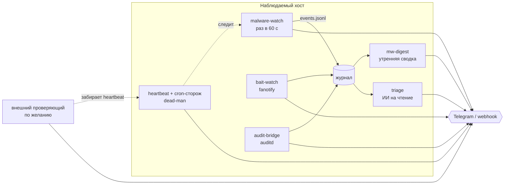

<p align="center">
  
</p>

<h1 align="center">Nightwarden</h1>

<p align="center"><b>Ночной сторож для Linux-сервера: за секунды замечает ботов класса Mirai, закрепление по краденым ключам и кражу секретов — и объясняет каждую тревогу человеческим языком.</b></p>

<p align="center">
  
  
  
  
  
</p>

<p align="center">
  <a href="#быстрый-старт">Быстрый старт</a> ·
  <a href="#зачем-это-появилось">Зачем это появилось</a> ·
  <a href="#возможности">Возможности</a> ·
  <a href="#как-это-устроено">Как устроено</a> ·
  <a href="README.md">English</a>
</p>

---

## Что внутри

| 🕵️ Видит | 🪤 Ловит | 🧠 Объясняет |
|---|---|---|
| Процессы с **удалённым бинарём**, запуск из памяти, подделку под `[kworker]`, reverse shell, порты ботнетов, новое закрепление (cron, systemd, `ld.so.preload`, ssh-ключи, sudoers…) | **Файлы-приманки**, похожие на забытые пароли. Судит по *поведению*: «обходит каталог» — тихо, «читает только секреты» — тревога | **Утренняя сводка** вместо потока сообщений и необязательный **ИИ-разбор**: расследует красную тревогу только на чтение и пишет вердикт |

Тревога выглядит примерно так (иллюстрация, сокращённо):

```text
🚨 Процесс без файла на диске держит соединение наружу
Что случилось: процесс «irqbalance» (pid 4121) запущен из файла, которого
на диске уже нет, и держит соединение наружу.
Чем это грозит: так ведёт себя уже работающий вредонос.
Что сделано: снимок улик сохранён, дерево процессов заморожено и убито.
тех: pid=4121 exe=/tmp/.x (deleted) · 2026-… UTC · myhost
```

> [!NOTE]
> Nightwarden — это **обнаружение и сдерживание**, а не замена файрволу. Он предполагает, что базовая гигиена у вас есть (см. [Безопасность](#безопасность)).

## Зачем это появилось

Проект написан в течение недели после настоящего взлома небольшого dev-сервера.

> **Исходные данные:** веб-терминал (`ttyd`) слушал `0.0.0.0` **без пароля**, файрвол на хосте был **выключен**, доступ — из локальной сети площадки. Ничего экзотического.

| Когда | Что произошло |
|---|---|
| **t = 0** | Кто-то из локальной сети площадки добирается до открытого веб-терминала. Кто и как — так и не установлено. |
| **t + 21 с** | На машине уже работает бот семейства Mirai. Весь взлом короче **60-секундного тика** любого опрашивающего монитора. |
| **Затем** | Имплант маскируется под `irqbalance` / `atd` / `[kworker]`, **удаляет собственный бинарь** и открывает слушатель на telnet-порту 23. |
| **Потом** | Собирает `~/.ssh`, истории шелла и все файлы `*.env` / `*secret*` / `*token*` на диске — **шесть проходов**. |
| **~2,5 суток** | Человек замечает неладное. Источник взлома **так и не установлен**: не было ни логов доступа, ни auditd, ни журнала файрвола. |

Какие выводы и что с ними делает репозиторий:

| Вывод | Ответ Nightwarden |
|---|---|
| «Нет аутентификации на сервисе с шеллом» — не риск, а открытая дверь | Сначала [чек-лист безопасности](#безопасность); детектор замечает новые слушатели не на loopback |
| Бот прятался под чужим именем, проверки по имени бессильны | Судим по **фактам**: `exe` с пометкой `(deleted)`, флаг `PF_KTHREAD` вместо имени `[kworker]`, `/proc/<pid>/fd` ведёт в сокеты |
| 21 с быстрее минутного опроса | Необязательный набор **Falco/eBPF** для реального времени; приманки срабатывают на *первое чтение* |
| Секреты утекли молча | **Файлы-приманки** + правила auditd на ваши настоящие секреты |
| 2,5 суток никто не знал | **Dead-man**: heartbeat, независимый сторож, внешний проверяющий — молчание само тревога |
| Нет логов — нет ответа «как зашли» | Логи заводятся **заранее**: журнал событий, auditd, пересылка аудита наружу |

Идеи обнаружения в виде индикаторов (обобщённые; адреса атакующих не публикуются):

```bash
# процесс, у которого исполняемый файл удалён, пока он работает
ls -l /proc/*/exe 2>/dev/null | grep deleted
# неизвестные слушатели (telnet 23, 2323, 7547, 48101, 53321 ...)
ss -ltnp
# процессы, притворяющиеся irqbalance / atd / dbus-launch
ps -ef | grep -E 'irqbalance|atd|kworker'
```

Полный разбор: [`docs/WHY.md`](docs/WHY.md) (на английском).

## Возможности

- ⏱ **Раз в минуту, 0 убийств на чистом хосте** — режим `dryrun` доказывает это до включения
- 🧯 **Узкий курок** — убивает только при нескольких независимых признаках; белый список проверяется первым; слабый сигнал = предупреждение, а не выстрел
- 🧊 **Улики до убийства** — копирует `/proc/<pid>/exe`, считает хэш, пишет cgroup/контейнер, сокеты и fd; убийство идёт через одноразовую cgroup и отменяется, если хоть один потомок в белом списке
- 🔐 **Закрепление по хэшу содержимого** — cron, systemd (юниты, дропины, сокеты, path), `ld.so.preload`, `rc.local`, shell rc, sudoers, sshd config, `authorized_keys` (включая файлы, которых *ещё нет*), docker posture, модули ядра, PAM, udev, набор SUID
- 🪤 **Приманки** судят по поведению (`/proc/<pid>/io`), а не по имени программы
- 📜 **Мост к auditd** — смена ключей входа, новая программа читает секреты, всплески чтений; жёсткий потолок частоты в единственной точке отправки
- 🔕 **Один рубильник тишины** на всё — с единственным намеренным исключением: *сторож умер*
- 🫀 **Цепочка dead-man** — heartbeat-сторож и тупой cron-сторож, переживающий `systemctl stop *.timer`
- 🧠 **ИИ-разбор** (по желанию, по умолчанию выключен) — сессия Claude Code только на чтение, жёсткие потолки трат, вердикт строгой формы
- 📬 **Тревоги куда угодно** — бот Telegram или любой JSON-webhook (Slack / Discord / ntfy-мост)

## Быстрый старт

```bash
git clone https://github.com/meshoklv/nightwarden && cd nightwarden
./install.sh --dry-run            # показывает, что будет установлено — ничего не меняет
sudo ./install.sh --with-bait     # устанавливает, НИЧЕГО не запускает
sudoedit /etc/malware-watch.env   # TG_TOKEN/TG_CHAT или ALERT_WEBHOOK_URL
sudo malware-watch.sh dryrun      # на чистом хосте должно быть 0 WOULD-KILL
sudo malware-watch.sh baseline    # принять текущее состояние как «норму»
sudo systemctl enable --now malware-watch.timer malware-watch-hb.timer
```

| Требование | Примечание |
|---|---|
| Linux с systemd, root | Разрабатывалось на Ubuntu 24.04, ядро 6.8 |
| `bash`, `jq`, `curl`, `python3` | `iptables`, `ss`, `nsenter`, `docker` необязательны (детекторы сужаются, но работают) |
| Канал для тревог | Токен бота Telegram и chat id **или** URL webhook |

> [!WARNING]
> Проверено: Ubuntu 24.04 (один хост автора). Не проверено: Debian, Fedora/RHEL, Alpine, системы без systemd. У каждого шага установщика есть `--dry-run`. **Перед включением прогоните `dryrun`.**

<details>
<summary>Все параметры установщика</summary>

```text
sudo ./install.sh [--dry-run] [--with-audit] [--with-bait] [--with-triage] [--enable]
  --with-audit    поставить правила auditd (правила для несуществующих путей отбрасываются)
  --with-bait     создать файлы-приманки и включить bait-watch
  --with-triage   поставить ИИ-разбор (выключен, пока сами не включите)
  --enable        выполнить dryrun+baseline и запустить таймеры
sudo ./uninstall.sh [--dry-run] [--purge]
```
</details>

<details>
<summary>Дополнительные наборы (автоматически не ставятся)</summary>

| Набор | Что делает | Статус |
|---|---|---|
| [`falco/`](falco/README.md) | Обнаружение в реальном времени на eBPF (Falco + falcosidekick) | экспериментальный |
| [`feeds/`](feeds/README.md) | Блок-лист из фидов угроз (abuse.ch, FireHOL, Spamhaus) в наборе nftables с автоистечением | экспериментальный |
| [`offbox/`](offbox/README.md) | Независимые хосты *забирают* heartbeat; молчание, подделка и сдвиг часов поднимают тревогу вне наблюдаемой машины | экспериментальный |
| [`triage/`](triage/README.md) | ИИ-разбор красных тревог | работает; нужен `ANTHROPIC_API_KEY` |
</details>

## Как это устроено



1. **malware-watch** раз в минуту смотрит процессы (включая все контейнеры через общий `/proc` хоста), сокеты и точки закрепления. Всё сравнивается по хэшу с базой, которая *никогда не переписывается сама*.
2. **Тревоги делятся** на red / amber / white. Красная уходит сразу; оранжевая ограничена по частоте и сворачивается в сводку; у каждой тревоги есть короткий код, которым её можно принять (`accept`) или отложить (`snooze`).
3. **bait-watch**, **audit-bridge** и по желанию **Falco** — независимые пути обнаружения, чтобы одна слепая зона не ослепляла всё.
4. **Цепочка dead-man** делает тишину громкой: если остановился сторож, его heartbeat или оба таймера — придёт сообщение, пробивающее тишину и ночные часы.
5. **Разбор** читает журнал (в отправку не врезается), снимает улики и даёт изолированной модели заполнить анкету; сообщение собирает жёсткий шаблон. Модель не может ничего отправить, запустить или изменить.

<details>
<summary>Компоненты</summary>

| Файл | Роль |
|---|---|
| `bin/malware-watch.sh` | основной сторож: `run`, `dryrun`, `baseline`, `status`, `accept <код>`, `snooze <код>`, `pending-json` |
| `bin/malware-watch-hb.sh` | heartbeat / dead-man |
| `bin/malware-watch-guard.sh` | намеренно тупой cron-сторож, не зависящий от таймеров systemd |
| `bin/bait-watch.py` | ловушка на приманки (`--selftest` ничего не отправляет) |
| `bin/bait-seed.sh` | создаёт файлы-приманки и список для ловушки |
| `bin/audit-bridge.py` | auditd → тревоги, обучение белого списка, суточный потолок на правило |
| `bin/mw-digest.py` | одна спокойная сводка в сутки |
| `bin/mw-buttons.py` | кнопки Telegram («это норма», «тихо 8 часов»); нужен **отдельный** бот |
| `audit/nightwarden.rules` | правила auditd для ключей, которые читает мост |
</details>

## Настройка

Всё живёт в `/etc/malware-watch.env` (см. [`etc/malware-watch.env.example`](etc/malware-watch.env.example)).

| Переменная | По умолчанию | Смысл |
|---|---|---|
| `TG_TOKEN`, `TG_CHAT` | — | токен бота Telegram и chat id |
| `ALERT_WEBHOOK_URL` | — | JSON-webhook, тело `{"text","content"}` (HTML вырезан) |
| `IOC_NETS`, `IOC_CIDRS` | пусто (модуль выключен) | известные вредоносные сети (regexp / CIDR); блок на вход и выход |
| `SELF_IPS` | — | ваши адреса выхода/VPN — никогда не считаются C2 |
| `TZ_OFFSET_H` | `0` | ваш сдвиг от UTC для тихих часов и сводки |
| `QUIET_LOCAL_FROM/TO` | `22` / `8` | в это окно уходит только красное |
| `AMBER_BUDGET` | `3` | некрасных сообщений в сутки |
| `EXTRA_HOME_GLOBS` | — | дополнительные домашние каталоги (контейнеры, воркспейсы) |
| `GITHOOK_ROOTS` | — | каталоги с git-репо, чьи хуки проверяются по хэшу |
| `VPNKS_RE` | пусто (выкл.) | docker-контейнеры, обязанные сидеть за VPN-туннелем |
| `AUDIT_JEWEL`, `AUDIT_BACKUP_UNIT` | общие | тонкая настройка моста auditd |

Безопасная репетиция: перед запуском чего-либо, что умеет отправлять, ставьте `MW_TEST_SILENT=1` / `HB_DRY_RUN=1`. Учебные прогоны не разбудят человека в час ночи.

## Безопасность

Nightwarden — *детектор*. Он не заменяет:

- **Ни одного сетевого сервиса без аутентификации** — особенно того, что даёт шелл (веб-терминалы, code-server, отладочные порты). Слушать `127.0.0.1`, наружу — только через фронт с паролем или токеном. «Это же локалка» — ровно так случился взлом выше.
- **Файрвол включён и переживает ребут** — дефолт INPUT drop; проверка: `ss -ltnp` и `ss -ltn | grep -v 127.0.0.1`.
- **Секреты не в лишних текстовых файлах** и один ключ — одна роль.
- Сам Nightwarden **не открывает слушающих портов**. ИИ-разбор работает от непривилегированного пользователя в песочнице только на чтение и не может ни отправить, ни выполнить, ни изменить.

О уязвимостях сообщайте приватно — см. [SECURITY.md](SECURITY.md).

## Ограничения

Честный список:

- **60 секунд слепой зоны** для короткоживущих процессов между тиками. Настоящее лекарство — набор Falco (реальное время), он экспериментальный.
- **Root на машине побеждает любой контроль на ней самой.** Внешний проверяющий сужает проблему («молчание = тревога»), но не отменяет. Руткит ядра, который врёт в `/proc`, bash-опросчику не виден.
- Часть детектов **только предупреждает по замыслу** (netcat со stdio-сокетом, утечка мимо VPN, docker posture), чтобы не убить легитимный процесс.
- **Тексты тревог сейчас на русском** (писались для автора); ИИ-разбор умеет английский и русский (`TRIAGE_LANG`). Перевод сообщений сторожа — в планах. Комментарии в коде тоже в основном русские.
- Белые списки придётся **подстроить под вашу активность** (node, браузеры, dev-инструменты): ожидайте первую притирку от часов до суток-двух.
- Автотестов пока нет, кроме `dryrun`, `--selftest` и selftest разбора.

## FAQ

**Он убьёт мою сборку?** Только когда несколько независимых признаков сходятся и никто из поддерева процесса не в белом списке. Слабый сигнал — просто предупреждение. `dryrun` показывает, что *было бы* убито.

**Есть Docker-образ?** Нет: детекторам нужны `/proc` хоста, `ss`, файрвол и systemd. Контейнер сторожил бы только сам себя.

**Нужна ли ИИ-часть?** Нет. Она отдельная, по умолчанию выключена и стоит денег за каждый разбор (жёсткие потолки: $0,60 за разбор, $3 в сутки).

## Планы

- [x] База закрепления по хэшу, улики до убийства, цепочка dead-man
- [x] Приманки, мост auditd, утренняя сводка, ИИ-разбор
- [ ] Английские тексты тревог (переключатель языка для всех отправителей)
- [ ] Нормальный набор тестов / CI на контейнере с поддельным `/proc`
- [ ] Пакет `.deb`
- [ ] Набор Falco — из экспериментальных в основные

## Участие

Issues и PR приветствуются — см. [CONTRIBUTING.md](CONTRIBUTING.md). Правило для контрибьюторов: никогда не запускайте отправляющие скрипты вне режима dry-run.

## Лицензия

[MIT](LICENSE)

---

<p align="center">Made by <a href="https://github.com/meshoklv">@meshoklv</a></p>
